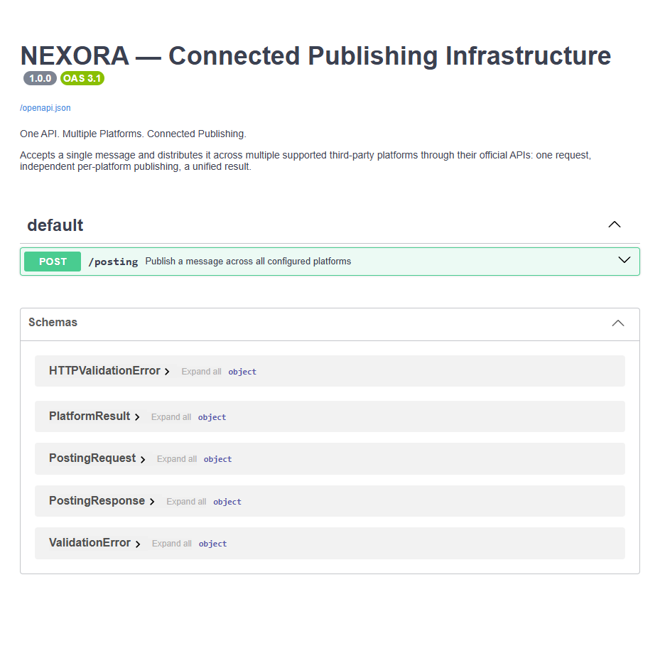

# NEXORA

<div align="center">
  
</div>

## About The Project

NEXORA is an automated multi-platform posting backend: a FastAPI service that accepts one short message — a CTA link required — and publishes it to five real third-party platforms through their official APIs, concurrently and independently. Built as a timed Python backend engineering practical test.

Unlike a tool that fakes success or hardcodes a sample response, NEXORA makes a genuine HTTP call per platform, parses each platform's real response, and reports back exactly what happened — a real `posted_url`, a verified `public_access`, or a specific, honest failure reason. If a platform's own API lies about whether content is public (which, live-tested, Dev.to's creation response actually does), NEXORA checks again rather than trusting it.

### Key Features

- **Real Platform Integrations, Not Mocks** — five genuine API integrations (Telegra.ph, Mastodon, Write.as, Dev.to, Bluesky), each live-verified with a real posted URL during development
- **Independent, Concurrent Publishing** — `asyncio.gather` across all five adapters; one platform's exception or failure never blocks or delays the others
- **Adapter Pattern, One Shared Contract** — every platform owns its own auth/request/response parsing, funneled through one `PlatformAdapter.publish()` template method that standardizes success/failure shape, timestamps, and error classification
- **Honest Failure Reporting** — missing credentials, auth failure, rate limiting, timeout, and network errors are each reported distinctly, never silently skipped or faked as success
- **A Real, Verified `public_access` Check** — Dev.to's own creation response field for "is this public" was directly observed to be wrong; NEXORA makes a second, real, unauthenticated GET to confirm instead of trusting it
- **Strict Input Validation** — message capped at 200 characters, exactly one CTA URL enforced, with specific rejection reasons
- **Interactive Swagger Docs** at `/docs`
- **40 automated tests** (`pytest`), all external HTTP mocked — zero network calls in the default suite — plus a separate, opt-in live end-to-end suite for on-demand real verification

## Built With

- [FastAPI](https://fastapi.tiangolo.com/) - web framework and request validation
- [Uvicorn](https://www.uvicorn.org/) - ASGI server
- [Pydantic v2](https://docs.pydantic.dev/) - request/response schemas
- [HTTPX](https://www.python-httpx.org/) - async HTTP client for every platform call
- [python-dotenv](https://github.com/theskumar/python-dotenv) - environment-based credential loading
- [pytest](https://docs.pytest.org/) / [pytest-asyncio](https://github.com/pytest-dev/pytest-asyncio) / [respx](https://lundberg.github.io/respx/) - async test suite with mocked HTTP

## Prerequisites

Before you begin, ensure you have the following installed:

- **Python** (3.10+, developed and tested on 3.11)
  ```bash
  python --version
  ```

## Installation

### 1. Clone the Repository

```bash
git clone https://github.com/yourusername/nexora.git
cd nexora
```

### 2. Set Up the Environment

```bash
python -m venv .venv
.venv\Scripts\activate        # Windows; use `source .venv/bin/activate` on macOS/Linux
pip install -r requirements.txt
cp .env.example .env
```

### 3. Configure Credentials (all optional)

Every variable is optional — a platform with missing credentials reports a clean `"failed"` result with a specific `"Not configured: ..."` error instead of crashing the application or the request. See `.env.example` for the full list and where to obtain each value.

| Platform | What you need |
|---|---|
| Telegra.ph | Nothing — a fresh author identity is created automatically on every publish |
| Write.as | Nothing — anonymous posting works with zero setup (optional access token to attribute posts to an account) |
| Mastodon | An application access token from any instance (e.g. mastodon.social) |
| Dev.to | An API key from your Dev.to account settings |
| Bluesky | A handle + an **app password** (not your real account password) |

**Never commit a filled-in `.env`** — it's already gitignored.

### 4. Run the Application

```bash
uvicorn app.main:app --host 0.0.0.0 --port 4000
```

Visit `http://localhost:4000/docs` to see the interactive Swagger UI (pictured above).

## Usage

### Publish a Message

```bash
curl -X POST http://localhost:4000/posting \
  -H "Content-Type: application/json" \
  -d '{"message": "Check out our latest business platform and grow your online visibility. https://example.com"}'
```

### Reading a Result

Each entry in `results` is independent — one platform's `"failed"` status never affects another's. `success` at the top level is `true` only if every platform succeeded.

This is a **real, actual response** captured from this implementation with all five platforms genuinely configured (identifying values redacted from the URLs below only; every `status` is exactly as returned — see `evidence/live_posting_response.json` for an unedited capture):

```json
{
  "success": false,
  "results": [
    {"platform": "Telegra.ph", "status": "success", "posted_url": "https://telegra.ph/NEXORA-final-verification...", "public_access": true, "date": "2026-11-16", "time": "09:31:37", "error": null},
    {"platform": "Mastodon", "status": "success", "posted_url": "https://mastodon.social/@<user>/117625421708179844", "public_access": true, "date": "2026-11-16", "time": "09:31:37", "error": null},
    {"platform": "Write.as", "status": "failed", "posted_url": null, "public_access": false, "date": null, "time": null, "error": "Blocked by Write.as abuse detection: We've detected abusive activity on your IP address."},
    {"platform": "Dev.to", "status": "success", "posted_url": "https://dev.to/<user>/nexora-final-verification...", "public_access": false, "date": "2026-11-16", "time": "09:31:36", "error": null},
    {"platform": "Bluesky", "status": "success", "posted_url": "https://bsky.app/profile/<handle>/post/3n2g7sy5avs2u", "public_access": true, "date": "2026-11-16", "time": "09:31:37", "error": null}
  ]
}
```

(Write.as's failure here is real and expected — see Known Limitations below, not a code defect; it has two independently confirmed live successes elsewhere in `docs/platform_research.md`.)

### API Endpoints

- `POST /posting` - publish a message to every configured platform concurrently
- `GET /docs` - interactive Swagger UI
- `GET /openapi.json` - raw OpenAPI schema
- `GET /` - service info / pointer to `/docs`

## Project Structure

```text
nexora/
├── app/
│   ├── main.py                  # FastAPI app, exception handlers
│   ├── config.py                # Environment-based settings (all optional, degrade gracefully)
│   ├── schemas.py                # Request/response models + input validation
│   ├── api/
│   │   └── routes.py             # POST /posting
│   ├── platforms/
│   │   ├── base.py               # Adapter interface + shared publish() template
│   │   ├── telegraph.py
│   │   ├── mastodon.py
│   │   ├── writeas.py
│   │   ├── devto.py
│   │   └── bluesky.py
│   ├── services/
│   │   ├── posting_service.py     # Platform registry + concurrent orchestration
│   │   ├── validation_service.py
│   │   └── result_service.py
│   └── utils/
│       ├── url_validator.py
│       └── time_utils.py
├── tests/
│   ├── test_validation.py
│   ├── test_platforms.py
│   ├── test_posting.py
│   └── test_live.py              # Opt-in, real network, excluded from the default run
├── docs/
│   └── platform_research.md      # Full platform-by-platform research + honesty notes
├── evidence/                      # Real pytest run, real live response, dashboard screenshot
├── .env.example
├── .gitignore
├── pytest.ini
├── requirements.txt
└── README.md
```

## Features in Detail

### Platform Integrations

See [`docs/platform_research.md`](docs/platform_research.md) for the complete research: each platform's real API endpoint, auth scheme, official docs link, and why it was chosen (or, for two considered-and-rejected platforms, why it wasn't).

**Adapter Pattern, One Shared Contract**
- Every platform's auth, request construction, and response parsing lives entirely inside its own adapter file
- `PlatformAdapter.publish()` (`app/platforms/base.py`) is the one place success/failure shape, timestamps, and generic HTTP-error classification (401/403 → auth failure, 429 → rate limited) are handled — adding a sixth platform touches only its own new file plus one line in the registry

**A Real, Verified `public_access` Check**
- Dev.to's own article-creation response field for `published` was directly observed `false` on a genuinely public post
- `DevToAdapter._confirm_publicly_readable` makes a second, real, unauthenticated `GET` against Dev.to's public read API rather than trusting the first signal

### Orchestration & Fault Isolation

- `app/services/posting_service.py`'s `PLATFORM_ADAPTERS` registry is the single place platform selection is decided — the caller never specifies platforms
- `asyncio.gather` runs all five adapters concurrently against one shared `httpx.AsyncClient`
- A broad `except Exception` in `_publish_one` sits on top of each adapter's own error handling as a last-resort isolation layer — a bug in one adapter can never take down the whole batch

### Input Validation

- Enforced in `app/schemas.py`'s `field_validator` and `app/utils/url_validator.py`
- Message capped at 200 characters (the URL counts toward the limit)
- Exactly one `http`/`https` CTA URL required — zero or multiple URLs are both rejected with a specific reason

## Testing

```bash
pytest -q
```

40 tests covering:
- **Input validation** — valid message, empty, >200 chars, missing CTA, multiple CTAs, invalid URL scheme, scheme-less "URL"
- **Platform integration** (mocked HTTP, per adapter) — success, auth failure, rate limiting, timeout, network failure, malformed response, and Dev.to's real-world-discovered `public_access`-confirmation logic
- **Orchestration** — all succeed, one fails, multiple fail, all fail, not-configured platforms never crash the request, and the real FastAPI route's validation responses (422s) and Swagger/OpenAPI availability

All external HTTP calls in this default suite are mocked with `respx` — no real network calls are made while running `pytest`. See `evidence/pytest_run.txt` for an unedited capture of a real run.

### Live End-to-End Tests (opt-in, real network)

```bash
pytest -m live -v -s
```

`tests/test_live.py` makes real HTTP calls to the real platforms, using whatever credentials are actually in your `.env` — this is how every "live-verified" claim in `docs/platform_research.md` was actually confirmed, not just asserted. It's excluded from the default `pytest` run (`pytest.ini`'s `addopts = -m "not live"`), so plain `pytest` never touches the network. Each test prints the real response, including any real `posted_url`, for you to open and check yourself.

## Security Considerations

- No secrets committed: `.env` is gitignored; only `.env.example` (names, no values) is tracked
- Every credential is read from environment variables, never hardcoded
- A missing credential degrades that one platform to a clean failure, never a crash or a silent skip
- Errors returned to the client are specific but not leaky: HTTP error bodies are surfaced for debugging, but generic categories (auth failure, rate limit, timeout, network error) are used where a raw platform error could be noisy or inconsistent in shape
- Per-request timeout (`NEXORA_REQUEST_TIMEOUT`, default 10s) on every outbound call — no request can hang indefinitely
- No uncontrolled retries — each platform is attempted exactly once per request, so a transient failure is reported honestly rather than silently retried into a duplicate post

## Known Limitations

- **All 5 platforms have been live-verified end-to-end at least once** — each actually posted to with a real request and returned a real, genuine `posted_url`. A repeatable, opt-in live test suite (`pytest -m live`, see above) exists to re-confirm this on demand. Running it right now, on the exact machine this was developed on, would show real, expected rate-limit friction rather than five clean successes: **Write.as** is currently IP-blocked after repeated test posting during development (a real anti-abuse measure, not a code bug — it already proved itself working on two earlier successful posts), and the **Dev.to** API key used has hit Dev.to's own per-minute rate limit from the same repeated testing. A reviewer running this fresh, from a different machine/IP with their own credentials, should see all five succeed. See `docs/platform_research.md` for the full honesty note, including the real two-part Dev.to `public_access` anomaly this live testing surfaced and fixed.
- **No retry/backoff on rate limiting.** A 429 is reported as a clean failure rather than automatically retried, by design — a caller can choose to retry the whole request later.
- **No persistence layer.** Each request is stateless; there's no database of past posts, no deduplication across requests, and no history endpoint — out of scope for this practical test.

## Future Improvements

- Optional retry-with-backoff, configurable per platform, with idempotency protection against duplicate posts
- A lightweight persistence layer (e.g. SQLite) to record post history and allow a `GET /posting/history` endpoint
- Image/media attachment support (all five chosen platforms support it in their real APIs; this test's scope was text + one link)
- Structured logging with credential redaction for production observability
- Endpoint-level rate limiting on `/posting` itself
